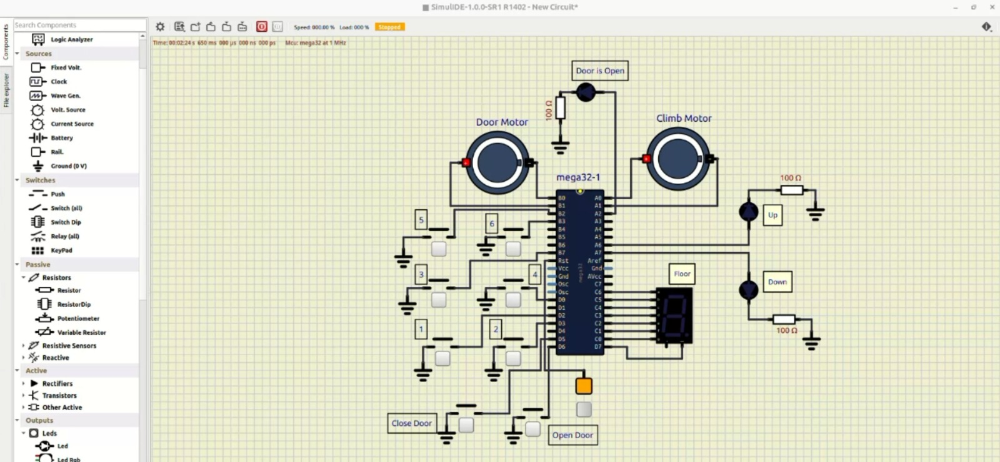
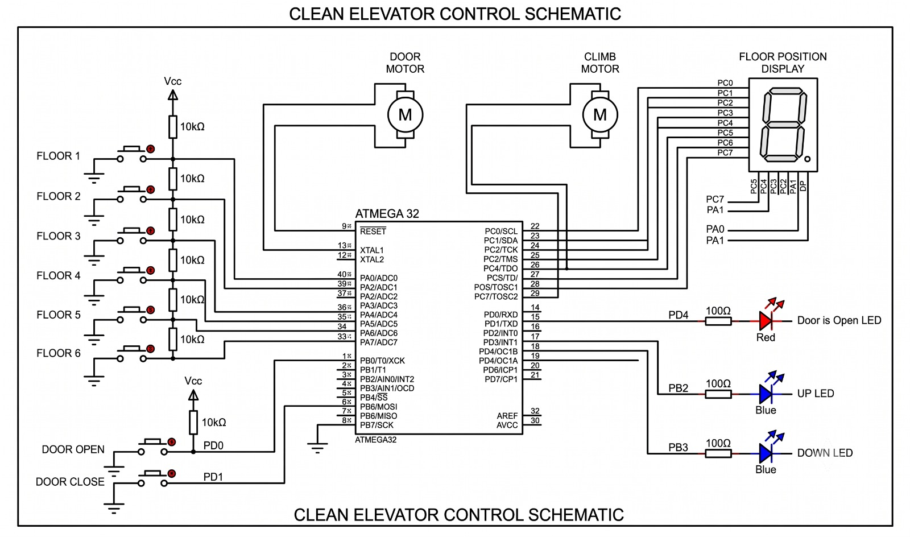
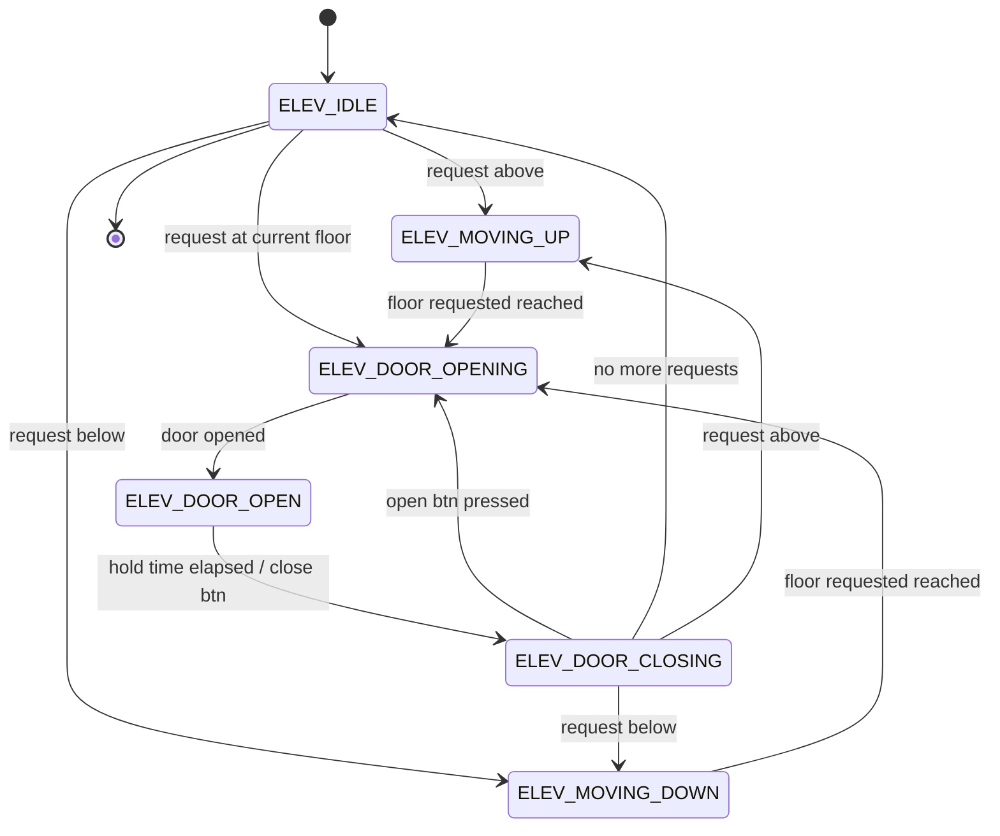

<div align="center">

# 🛗 AVR Elevator Controller

**NTI Embedded Systems internship Graduation Project**

*Developed by:*<br>
**Aly Eldowaik** <a href="https://www.linkedin.com/in/ali-aldowaik-18510b372/"></a> | **Fares Elsherif** <a href="https://www.linkedin.com/in/fares-elsherif-123945378"></a> | **Mohanad Mohamed** <a href="https://www.linkedin.com/in/mohanad-mohamed-8714ba305"></a>

A complete, state-machine-driven elevator controller built for the AVR ATmega32.
It handles 6-floor call logic, DC-motor cabin/climb and door actuation, a 7-segment
floor display, direction indicators, and a fully debounced 8-button control panel —
all in C with a clean layered driver architecture.



---

<a href="https://en.wikipedia.org/wiki/C_(programming_language)"></a>


</div>
---

## 📖 Table of Contents

- [Overview](#-overview)
- [Hardware Demo](#-hardware-demo)
- [Features](#-features)
- [Hardware & Pin Mapping](#-hardware--pin-mapping)
- [Software Architecture](#-software-architecture)
- [State Machine](#-state-machine)
- [Building the Project](#-building-the-project)
- [Repository Structure](#-repository-structure)
- [How It Works](#-how-it-works)
- [Team](#-team)
- [Future Improvements](#-future-improvements)

---

## 📌 Overview

This project is a **6-floor elevator controller** implemented on an ATmega32
microcontroller. The cabin moves up and down between floors using a dedicated
**climbing DC motor**, while a second **DC motor** handles the cabin door. A single
seven-segment display always shows the current floor, and a pair of LEDs indicate
the active travel direction.

The core logic is implemented as a **deterministic state machine** running on a
fixed 1 ms software tick. All button inputs are processed through an independent
debounce finite-state machine before any request reaches the main elevator state
machine — one press always produces exactly one action.
```
┌──────────────────────────────────────────────────────────────┐
│                        AVR ELEVATOR                          │
│                                                              │
│   ┌────────┐   FLOOR BUTTONS (x6)   ┌────────────────┐       │
│   │  7-Seg │◄─────── Display ───────│                │       │
│   │  (FD)  │                        │  ATmega328     │       │
│   └────────┘   Direction LEDs       │  State Machine │       │
│                                     │                │       │
│   ┌────────┐   Door LED             │  ├─ Climb Motor│       │
│   │ Panel  │──►(debounced)─────────►│  ├─ Door Motor │       │
│   │ 8 BTNs │   buttons             │  └─ 7-Seg Sink │       │
│   └────────┘                       └────────────────┘       │
└──────────────────────────────────────────────────────────────┘
```
---

## 🎥 Hardware Demo

Watch the physical implementation and hardware demonstration of the elevator controller in action:
👉 **[Watch the Demo Video on Google Drive](https://drive.google.com/drive/folders/1kQPZIzeC9BJpLii9P3LvDX5eFKlg9DQU?usp=sharing)**

---

## ⚡ Features

- **6-floor call routing** with an elevator-scanning algorithm (services calls and
  keeps sweeping in the current direction before reversing).
- **Non-blocking cooperative scheduler** running all tasks on a single 1 ms tick.
- **Fully debounced 8-button panel** (6 floor buttons + Door Open + Door Close) with
  an independent debounce FSM per button.
- **Two DC motors** — one for cabin climb (up/down) and one for the door (open/close)
  — each driven through forward/backward GPIO pairs.
- **7-segment floor display** (common cathode) with dynamic enable.
- **Direction LEDs** that reflect the actual sweeping direction, plus a door-state LED.
- **Door auto-hold and auto-close** with configurable open/close timing.
- Pure **layered driver design** (`DIO` → peripheral HAL → application).

---

## 🔩 Hardware & Pin Mapping

### Inputs

| Button              | Port Pin |
|---------------------|----------|
| Floor 1              | PD2      |
| Floor 2              | PD3      |
| Floor 3              | PB7      |
| Floor 4              | PD0      |
| Floor 5              | PB2      |
| Floor 6              | PB3      |
| Door Open            | PD6      |
| Door Close           | PD5      |

### Outputs

| Peripheral           | Port Pin | Port Pin (Drive) |
|----------------------|----------|------------------|
| Climb Motor Forward  | PA0      |                  |
| Climb Motor Reverse  | PA1      |                  |
| Door Motor Open      | PB1      |                  |
| Door Motor Close     | PB0      |                  |
| 7-Seg a…g            | PC0–PC6  |                  |
| 7-Seg Enable         | PD7      |                  |
| Up Direction LED     | PA6      |                  |
| Down Direction LED   | PA7      |                  |
| Door Open LED        | PA2      |                  |

### Second Schematic

|  |
|---|

---

## 🧠 Software Architecture

The firmware is split into reusable layers so the elevator logic stays
independent of the raw registers:

```
┌─────────────────────────────────────────────┐
│              main.c (Application)           │
│   Elevator FSM + Button dispatch            │
├─────────────────────────────────────────────┤
│   HDC_Motor   HSSD   HLED   HSWITCH        │   ← Hardware Abstraction Layer (HAL)
├─────────────────────────────────────────────┤
│   MDIO  (MCU Digital I/O driver)            │   ← MCAL
└─────────────────────────────────────────────┘
```

| File                     | Role                                                     |
|--------------------------|----------------------------------------------------------|
| `MDIO_interface.h` / program | AVR digital I/O driver (pin setup, DDR/PORT/READ/PULLUP). |
| `HDC_Motor_*` /           | DC-motor HAL: forward, backward, stop through 2 GPIO.        |
| `HSWITCH_*`               | Switch reading (pressed/released), mux.              |
| `HSSD_*`                  | 7-segment multiplexer/decoder + enable + display.          |
| `HLED_*`                  | LED on/off/toggle management.                              |
| `main.c`                  | Top-level elevator scheduling + state machines.            |
| `Makefile`               | AVR-GCC build script producing `.hex` and `.elf`.          |
| `main.hex`                | Prebuilt flashable firmware.                               |

---

## 🌐 State Machine

The elevator is modeled as an explicitly coded **Moore-style state machine** with a
little well-understood dispatch logic. Every state runs an **entry action** once and,
on a fixed timing interval, performs a tick action. All timing is driven by the
1 ms tick counter.

### States

- `ELEV_IDLE`
- `ELEV_MOVING_UP`
- `ELEV_MOVING_DOWN`
- `ELEV_DOOR_OPENING`
- `ELEV_DOOR_OPEN`
- `ELEV_DOOR_CLOSING`



### Button Debounce FSM (per button)

```
BUTTON_RELEASED ──► BUTTON_PRESS_DEBOUNCE ──► BUTTON_PRESSED
      ▲                    │                          │
      │                    ▼                          ▼
      └── BUTTON_RELEASE_DEBOUNCE ◄───────────────────┘
```

---

## 🛠 Building the Project

The project ships with a complete **AVR-GCC** for the `ATmega328`.

```bash
make            # compiles and links, producing main.hex and main.elf
make clean      # removes build artifacts
```

The prebuilt firmware is already provided at `13-App-Elevator-System/main.hex` and can
be flashed with:

```bash
avrdude -p atmega328p -c usbasp -U flash:w:13-App-Elevator-System/main.hex
```

> Adjust the programmer (`-c`) and port to your own hardware.

---

## 📁 Repository Structure

```
AVR-Elevator-Controller/
├── 13-App-Elevator-System/
│   ├── main.c                     # Application / state machine
│   ├── Makefile                   # Build system
│   ├── main.hex / main.elf        # Flashed binary artifacts
│   ├── MDIO_interface.h/c         # AVR DIO driver
│   ├── HDC_Motor_interface.h/c    # DC dual motor driver
│   ├── HSWITCH_interface.h/c       # Switch HAL
│   ├── HSSD_interface.h/c         # 7-segment HAL
│   ├── HLED_interface.h/c         # LED HAL
│   └── STD_TYPES.h / BIT_MATH.h   # shared typedefs & bit macros
├── images/
│   └── schematic-1.jpeg, schematic-2.jpeg
└── README.md
```

---

## 🎛 How It Works

1. The main loop advances a global **1 ms tick** once per iteration.
2. All **8 buttons** are scanned every tick; each goes through its own debounce FSM,
   so mechanical chatter never produces more than one action.
3. Floor buttons only **set a request flag** — they never touch a motor directly.
4. The elevator FSM dispatches on every tick: it scans for pending requests above/below
   the current floor, keeps sweeping in its current direction, and opens the door only
   at requested floors.
5. The door auto-opens, holds for 3 seconds, auto-closes, then the dispatcher re-runs
   to serve the next request or return the cabin to idle.

---

## 🧩 Future Improvements

- [ ] Add interrupt-driven scheduling so tasks only tick when an event occurs.
- [ ] Replace timed floor travel with a real position sensor (e.g. hall / IR) for
      accurate floor detection.
- [ ] Add a buzzer and door-obstruction detection for safety.
- [ ] Persist current floor in EEPROM so the cabin resumes on power-up.

---

<div align="center">

> **AVR Graduation Project** — built with hard work and ❤️.

</div>
